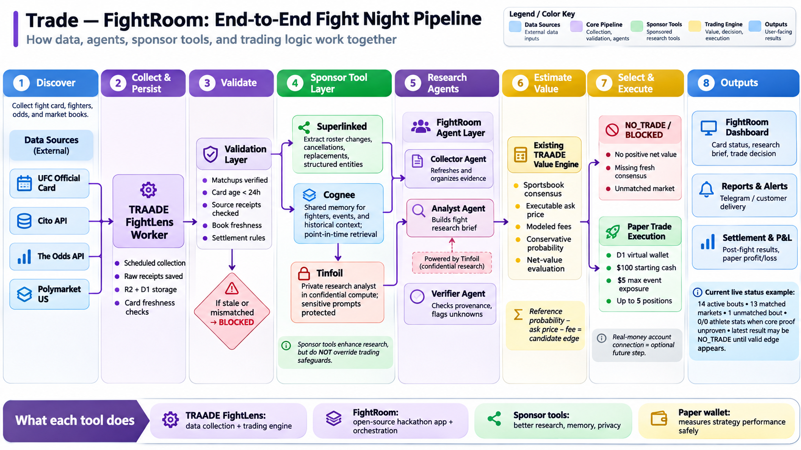

# Trade — FightRoom

**Open-source, evidence-first UFC fight-night research and paper-trading orchestration.**

FightRoom is a hackathon project that connects fight-card and fighter information, sportsbook odds, and prediction-market prices to an auditable research workflow. Agents can help discover roster changes, retrieve supporting evidence, and explain candidate trades; **deterministic validation, fee and risk rules decide whether any paper trade qualifies**.

> **Project status (November 7, 2026):** This public repository is a **clean-room, reproducible evidence demo**, not the private TRAADE production engine or a live-trading application. Its November 7 run demonstrated **Superlinked hosted SIE extraction with source spans, Cognee Cloud memory write/readback by separate analyst and verifier requests, and Tinfoil confidential inference with SDK-verified enclave attestation**. It also independently replayed the saved 19:30 UTC paper evaluation: **`NO_TRADE`, 0 candidates, 13 market rejections, and no profit**. See [`docs/EVIDENCE.md`](docs/EVIDENCE.md) and the sanitized [`artifacts/`](artifacts/) files. The end-to-end architecture below remains a broader design; the repo does not contain every diagrammed system.



*Architecture diagram: data sources → TRAADE collection → verification → sponsor-assisted research → deterministic value checks → `BLOCKED`, `NO_TRADE`, or paper execution → reporting and eventual settlement. The image reflects the design and an earlier production sample, not a live dashboard.*

## What problem does FightRoom solve?

Fight-night markets change quickly. A canceled bout, a replacement fighter, a stale sportsbook price, or a mismatched prediction-market contract can make an apparently attractive opportunity invalid. AI-generated analysis can also sound convincing without citing verifiable data.

FightRoom is being built to answer four questions for **each** UFC matchup:

1. **Is the fight and market actually valid right now?** Check the official card, replacements, market identity, freshness, settlement rules, and raw evidence receipts.
2. **What does verified fight research say?** Let agents extract changes, retrieve time-appropriate historical context, and produce source-backed briefs with explicit unknowns.
3. **Is there a measurable opportunity after fees?** Compare a conservative sportsbook-derived reference probability with an executable market price, venue fees, and configured risk limits.
4. **What happened to the strategy?** Record a paper decision and, only where a candidate qualifies, a simulated trade. Track virtual exposure and ultimately settle only against authoritative venue resolutions.

The desired outcome is a **reproducible, open-source research-to-paper-trading pipeline** that can be demonstrated on the November 7, 2026 UFC Fight Night and extended to future events. A qualified trade is not guaranteed. A correct `NO_TRADE` is a successful safety outcome when the evidence or net value is insufficient.

## Data flow and responsibilities

| Stage | Owner / technology | Responsibility | Required outcome |
| --- | --- | --- | --- |
| 1. Discover | Official UFC information, Cito API, The Odds API, Polymarket US | Identify bouts and fighters, market contracts, sportsbook reference odds, and available order books | Timestamped input identities |
| 2. Collect & persist | **TRAADE FightLens Worker** (existing private system) | Scheduled ingestion; capture source receipts in R2; maintain research snapshots and a virtual D1 ledger | Immutable, attributable evidence |
| 3. Validate | Deterministic verification | Reconcile replacements/cancellations; check matchup, event day, source age, market state, book depth, fees, rules, and receipts | Valid evidence or `BLOCKED` with reason |
| 4. Sponsor research | **Superlinked, Cognee, Tinfoil** | Extract roster changes, retrieve evidence-backed historical context, run confidential model inference where verified | Sourced research artifacts; never trading authorization |
| 5. Research agents | FightRoom Collector, Analyst, Verifier | Organize evidence, write a traceable research memo, independently flag unsupported claims | Research brief and citations |
| 6. Estimate value | TRAADE deterministic value evaluator / compatible FightRoom adapter | Compute sportsbook consensus reference, executable ask, modeled fees, conservative probability and net edge | Versioned decision with full inputs |
| 7. Select & execute | Deterministic gates and D1 **paper** wallet | Emit `BLOCKED` / `NO_TRADE` or record an idempotent paper entry subject to configured exposure | Paper-only audit receipt, never a live order |
| 8. Report & settle | FightRoom, Telegram, official market resolution | Present decision and supporting evidence; after the market resolves, calculate final simulated P&L | Separate reports and verified settlement |

### Sponsor integrations — actually demonstrated on November 7

The sponsor technologies have distinct responsibilities in **research**, not in authorizing trades. The dated sanitized evidence is described in [`docs/EVIDENCE.md`](docs/EVIDENCE.md) and the integration configuration is documented in [`docs/INTEGRATIONS.md`](docs/INTEGRATIONS.md).

| Sponsor | Implemented and evidenced in the saved run | What it does for FightRoom | What the proof does **not** establish |
| --- | --- | --- | --- |
| **Superlinked (SIE)** | Hosted entity-extraction call identified **Lucas Brennan, Austin Bashi and Carlos Calderon**, including character offsets/source spans checked against the November 4 official roster-change notice | Converts unstructured fight announcements and replacement notices into names and traceable event changes | It does not itself validate a market contract, calculate an edge, or make a trade |
| **Cognee Cloud** | A dated source note was stored; **separate analyst and verifier retrievals** recovered the correction | Supplies scoped, source-backed memory and consistent context for independent research agents | A single successful memory read is not proof of a comprehensive historical fighter model or point-in-time forecasting accuracy |
| **Tinfoil** | Official SDK inference produced a source-grounded roster memo; **enclave attestation was verified** | Supports a confidential research analyst and provides evidence about where inference ran | Attested inference does not imply profitable predictions, live confidential trading, or audited app-wide privacy |

**What the agents demonstrated:** extract the officially reported Brennan → Calderon replacement opposite Austin Bashi; write and recall the dated event through two research roles; generate an attested, source-grounded explanation. Real extraction, memory retrieval and inference occurred, but **no calibrated fighter win probability** or trading authorization came from those tools.

**Security:** Secrets, private tenant URLs, raw market books, and private TRAADE implementation are intentionally excluded from this public repository. Fixtures and response hashes are safe, sanitized artifacts, not substitute proof of a live trading account.

## Why TRAADE and FightRoom are separate

- **TRAADE** is the existing private operational source: event collection, source receipts, price/fee logic, paper-wallet state, and historical settlement behavior.
- **trade-fightroom** is the public hackathon project: a reproducible clean-room research run, sponsor integration evidence, recorded paper-decision replay and documented architecture. A full user-facing application is not included here.
- FightRoom should pull permitted **read-only API data** from TRAADE or use clearly labeled public/replay fixtures. It must not publish private TRAADE source code, API credentials, customer data, or internal receipts without explicit rights and review.
- The research system is designed so provider adapters can be replaced without changing the policy that governs paper decisions.

## November 7 verified evidence and limits

The sanitized evidence documents a **saved production observation collected at 19:30 UTC on November 7, 2026** and a matching deterministic replay. This is a historical snapshot, **not a continuously updated live market feed**.

| Check | What was actually observed |
| --- | --- |
| Event | UFC Fight Night: Cortes Acosta vs Walker |
| Official card / matching | 14 active bouts; 13 matched Polymarket US books |
| Roster update | Carlos Calderon replaced Lucas Brennan opposite Austin Bashi, according to the November 4 official notice |
| Unmatched contract | Carlos Calderon vs Austin Bashi; **no synthesized trade** |
| Sponsor extraction | Superlinked returned all three fighter names, with verified source spans |
| Source memory | Cognee write and two independent readbacks of the dated correction |
| Confidential inference | Tinfoil produced a roster memo with SDK-verified enclave attestation |
| Trading evaluator | **`NO_TRADE`**, 0 candidates, 13 rejected markets in saved 19:30 UTC production observation and replay |
| Rejections | 11 no positive fee-adjusted net value; 2 had no exact same-date sportsbook matchup (Ko–Turman; Lorenco–Petersen) |
| Fighter statistics | Recovery requested 28 fighter slots, 19 returned some data, **0 qualified** under combined fresh-and-consistent validation |
| Virtual strategy wallet | $100 cash; $0 exposure; $5 exposure cap; 0 trades; **no settled paper profit** |
| Telegram | Available delivery receipt refers to **17:15 UTC**, not evidence of a separate 19:30 UTC notification |
| Real-money trading | No connected external wallet, deposits, live orders, or order-submission capability in this public demo |

See [`docs/EVIDENCE.md`](docs/EVIDENCE.md), [`docs/ISSUES.md`](docs/ISSUES.md), and the sanitized evidence in [`artifacts/`](artifacts/). The two missing-consensus cases lacked **exact same-date matchup rows** in the captured sportsbook payload; their cause must not be described as merely a stale quote. The missing fighter-stat qualification must not be treated as proof that fighter data does not exist.

## How decisions work

```text
Official/event/market data
          │
          ▼
Source and roster validation ── insufficient/invalid ──► BLOCKED
          │
          ▼
Sponsor-assisted, cited research (optional, non-authorizing)
          │
          ▼
Deterministic sportsbook-versus-market value model
          │
          ├── complete evidence, no sufficient net edge ──► NO_TRADE
          │
          └── sufficient verified edge and risk gates pass
                                         │
                                         ▼
                                  PAPER CANDIDATE
                                         │
                                         ▼
                                 Virtual D1 paper wallet
                                         │
                                         ▼
                         Post-event official resolution & P&L
```

The legacy value model uses a conservative sportsbook-consensus reference and fee-inclusive market costs. It is **not** a validated, independently trained fighter-stats forecasting model. Agents can explain evidence and produce hypotheses, but cannot substitute made-up win probabilities or override decision gates.

## Goal, evaluation and financial truth

The ambitious project goal is a **traceable research → candidate evaluation → paper entry → official resolution → P&L** pipeline, with sponsor-backed research and no fabricated predictions. The saved run instead proves that the system can decline all available markets when its value gates fail.

- **Paper P&L** means virtual starting cash, open exposure, paper fills, and *settled* simulated profit or loss. A $100 unchanged virtual balance and 0 trades are **not $100 in revenue or $0 of proven investing performance**.
- **Real trade / $1 goal:** A genuine realized dollar requires an authorized live venue account, validated order/fill receipt, final market resolution, and reconciliation of fees. **This repository contains no live order-execution code**, and the saved run cannot support such a claim.
- **Model validity:** A single winning fight or fabricated position is not evidence of a repeatable edge; win probabilities and settlement results need their own calibration and proof.
- **Do not force a winner:** Sponsor research does not override stale-data, matchup, fee, price, or risk gates. `BLOCKED` and `NO_TRADE` are legitimate outcomes.

## Engineering priorities

1. **Keep the verified sponsor proof:** maintain source-span extraction, two independent Cognee recalls and verified Tinfoil attestation, with sanitized receipts.
2. **Finish fighter-stat qualification:** align Cron collection and proof validation; record actual fresh/consistent counts, never display `0/0` as complete fighter coverage.
3. **Inspect the negative-value decisions:** retain full per-market odds/ask/fee/edge explanations; separately investigate two missing exact same-date sportsbook matchups.
4. **Demonstrate paper lifecycle with controlled fixtures:** prove idempotent entry, wallet exposure and authoritative settlement without pretending any production trade occurred.
5. **Keep real orders out of this repo until separately approved and implemented:** the current published demonstration is a paper decision replay, not a brokerage product.

## Run the public demo

This repository contains a **real Node.js 20+ evidence verification harness**, fixtures, sanitized integration outcomes, and tests. It does **not** contain the private production worker or an order-submission implementation.

```bash
npm test
npm run verify
```

These commands check saved evidence and fixtures **offline**; they do not call private providers, verify the current market, or rerun sponsor requests. For detailed reproduction limits, see [`docs/EVIDENCE.md`](docs/EVIDENCE.md). Local configuration variable names are in [`.env.example`](.env.example); never commit `.env`, provider keys or tenant identifiers.

## Repository contents

| Path | Purpose |
| --- | --- |
| `README.md` | Goal, pipeline diagram, role boundaries and status |
| `docs/images/fightroom-pipeline.png` | End-to-end architecture image |
| `docs/EVIDENCE.md` | Traceability and limits of the November 7 run |
| `docs/INTEGRATIONS.md` | Superlinked, Cognee and Tinfoil implementation notes |
| `docs/ISSUES.md` | Remaining data-quality, settlement and alert gaps |
| `artifacts/` | Sanitized sponsor and deterministic replay evidence |
| `fixtures/` | Saved event inputs for offline tests |
| `scripts/verify-evidence.mjs` | Evidence-verification command |
| `test/` | Tests for the clean-room evidence harness |

## License

MIT — see [`LICENSE`](LICENSE).

## Sources and attribution

- [Original private TRAADE platform](https://github.com/thetradingdoc/traade) — read-only reference and existing FightLens pipeline (access-controlled)
- [Official UFC website](https://www.ufc.com/) — schedule and roster announcements
- [Superlinked documentation](https://superlinked.com/docs)
- [Cognee documentation](https://docs.cognee.ai/)
- [Tinfoil documentation](https://docs.tinfoil.sh/)

**Project scope:** a clean-room sponsor-backed research/evidence demo with a verified no-trade paper replay. No claim of guaranteed return, calibrated predictive accuracy, live betting, or positive P&L.
